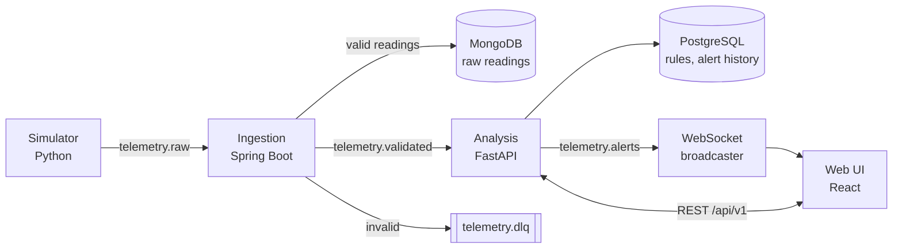

# Telemetry anomaly platform

[](https://github.com/Guimineve/telemetry-anomaly-platform/actions/workflows/ci.yml)
[](https://github.com/Guimineve/telemetry-anomaly-platform/actions/workflows/cd.yml)

A small streaming platform that notices when a sensor value goes out of range, changes too fast, looks statistically odd, or when a device goes silent. A Python simulator publishes telemetry for fake devices to Kafka. A Spring Boot service validates and stores it. A FastAPI service applies rules and raises alerts, which a React page shows live over WebSocket.

It is a portfolio project, inspired by the ground-control domain. All data and design are invented and my own. It has not been run in production.

## Architecture



| Component | Tech | What it does |
|---|---|---|
| [simulator/](simulator) | Python, aiokafka, FastAPI | Several devices (temperature, voltage, pressure, heartbeat) with noise. HTTP control port to inject `drift`, `spike`, `dropout` and `malformed` faults. |
| [ingestion/](ingestion) | Java 21, Spring Boot 3.5, Spring Kafka | Validates each message against [the JSON Schema contract](contracts/reading.schema.json). Valid readings are upserted into MongoDB (keyed by reading id, so redelivery is idempotent) and forwarded; invalid ones go to the dead-letter topic with a `reason` header. |
| [analysis/](analysis) | Python, FastAPI, SQLAlchemy, Alembic | Pure rules engine (below), Kafka worker, REST API, WebSocket, users and login. Rules, alert history and users live in PostgreSQL. |
| [web/](web) | React, Vite, TypeScript | Login and sign-up, live alert feed, filterable history with acknowledge, rules list, user management for admins. |
| [deploy/k8s/](deploy/k8s) | Kustomize | Manifests for everything, with a kind overlay. |

Topics are keyed by device id, so one device's readings stay ordered and its rule state lives on one analysis replica.

### Rules

| Type | Fires when |
|---|---|
| `threshold` | value is above `max` or below `min` |
| `rate_of_change` | absolute change per second over a window exceeds `max_rate_per_s` |
| `missing_heartbeat` | no heartbeat has arrived from a device for `timeout_s` |
| `zscore` | value is more than `threshold` standard deviations from the rolling mean of recent values |

Each rule keeps an open/resolved state per device, so a sustained breach produces one `open` alert and later one `resolved`, not one per reading. A cooldown stops a flapping value from re-opening immediately. Six default rules are seeded into an empty database.

## Run it

Needs Docker with the compose plugin.

```bash
docker compose up --build --wait
open http://localhost:3000        # live view; REST docs at http://localhost:3000/docs
```

Log in as `admin` / `admin-dev-password` (development credentials from [docker-compose.yml](docker-compose.yml)), or create a viewer account on the login page.

Make something happen:

```bash
# a temperature spike on one device -> threshold alert within about a second
curl -X POST localhost:8001/faults -H 'content-type: application/json' \
  -d '{"kind":"spike","deviceId":"sensor-001","metric":"temperature","magnitude":50}'

# silence a device for 25 s -> "Device silent" alert opens, then resolves when it returns
curl -X POST localhost:8001/faults -H 'content-type: application/json' \
  -d '{"kind":"dropout","deviceId":"sensor-002","durationS":25}'

# 3 bad payloads -> rejected by ingestion and sent to telemetry.dlq
curl -X POST localhost:8001/faults -H 'content-type: application/json' \
  -d '{"kind":"malformed","deviceId":"sensor-003","count":3}'
```

Add your own rule (admins only, so log in first and keep the session cookie):

```bash
curl -c /tmp/telemetry.cookies -X POST localhost:3000/api/v1/auth/login -H 'content-type: application/json' \
  -d '{"username":"admin","password":"admin-dev-password"}'
curl -b /tmp/telemetry.cookies -X POST localhost:3000/api/v1/rules -H 'content-type: application/json' \
  -d '{"name":"Pressure high","type":"threshold","metric":"pressure","params":{"max":110},"severity":"warning"}'
```

### Users and login

| Role | Can |
|---|---|
| `viewer` | See live alerts, alert history and rules; acknowledge alerts. Anyone can sign up as a viewer. |
| `admin` | Everything a viewer can, plus create, change and delete rules, and change users' roles or disable them. |

- The first admin comes from `ADMIN_USERNAME` / `ADMIN_PASSWORD`. It is created at startup only if no user has that name, so changing the variable later does not reset an existing password. Sign-up never creates an admin; an admin promotes users.
- Logging in sets an `HttpOnly`, `SameSite=Strict` cookie holding a JWT (HS256, signed with `JWT_SECRET`, 8 h by default) with only the user id in it. The user is loaded on every request, so a role change or a disabled account takes effect immediately. `COOKIE_SECURE` (`auto`, `true`, `false`) controls the `Secure` flag.
- Passwords are hashed with argon2id. Login answers the same way for an unknown user and a wrong password, and five failures per minute for a username or client IP returns 429.
- Every `/api/v1` route and `/ws/alerts` needs the session. The WebSocket also refuses a browser `Origin` that does not match the host. `/health`, `/ready`, `/docs` and `/openapi.json` stay public.
- The service refuses to start with a `JWT_SECRET` shorter than 32 characters.
- The web container sends `X-Content-Type-Options`, `X-Frame-Options: DENY`, `Referrer-Policy` and `Permissions-Policy` on every response, hides its nginx version, and gives the app page a strict `Content-Security-Policy` (same-origin scripts, styles and connections only). `/docs` is excluded from the CSP because Swagger UI loads from a CDN. HSTS belongs at a TLS-terminating ingress, which this repo does not have yet.

The API is documented in [docs/openapi.json](docs/openapi.json), generated from the code and checked for drift in tests and CI.

### Kubernetes (kind)

Needs Docker, [kind](https://kind.sigs.k8s.io) and kubectl.

```bash
docker build -t telemetry-simulator:dev simulator
docker build -t telemetry-analysis:dev analysis
docker build -t telemetry-web:dev web
docker build -t telemetry-ingestion:dev -f ingestion/Dockerfile .
KEEP_CLUSTER=1 scripts/kind-e2e.sh telemetry- dev     # create cluster, deploy, run the smoke test
# the web UI is then on http://localhost:3000 (NodePort 30080 mapped by deploy/k8s/overlays/kind/kind-config.yaml)
```

## How it was tested

Everything below runs in GitHub Actions on every push ([ci.yml](.github/workflows/ci.yml)). Counts are as of the last milestone.

| What | How |
|---|---|
| Rules engine | 25 unit tests with an injected clock: boundaries, sustained breach, per-device state, cooldown, restart restore, rate of change, z-score warm-up, heartbeat timeout and startup grace. |
| Contracts | The simulator's output and the alert JSON are validated against the JSON Schemas in [contracts/](contracts). |
| Ingestion | 13 validator unit tests; 3 Testcontainers integration tests on real Kafka and MongoDB (valid reading stored and forwarded, bad message to the DLQ with a reason, duplicate delivery stored once). |
| Analysis | Unit tests for the pipeline's retry behaviour and the HTTP layer (with an in-memory store), including login, sign-up, sessions, rate limiting, role checks and WebSocket auth; Testcontainers tests on real PostgreSQL and Kafka for migrations, SQL queries (including unique usernames under concurrent inserts), and the whole flow from `telemetry.validated` to an alert on `telemetry.alerts` plus a database row. |
| Web | 16 vitest tests (WebSocket reconnect/backoff, de-duplication, query building, login/sign-up/logout, return to login on 401, admin-only controls), type-check and production build. |
| End to end | [scripts/smoke.py](scripts/smoke.py) runs against the full compose stack and, again, against a kind cluster. It logs in as the admin, checks that requests without a session are refused and that a newly registered viewer cannot change rules, then injects a spike and asserts exactly one threshold alert, seen both on the WebSocket and in the REST history; then malformed messages (rejected) and a dropout (silent-device alert opens, then resolves). |
| Images and manifests | All four images are built; manifests are validated with kubeconform; the kind job deploys them. CD re-runs the kind smoke test on the images it just published to GHCR. |

Not tested: more than one analysis replica, any real hardware, long runs, security.

## Failure modes

[scripts/failure_modes.py](scripts/failure_modes.py) stops each dependency in the running compose stack in CI and checks nothing is lost. The last column says what was actually exercised.

| Down | Behaviour | Verified in CI |
|---|---|---|
| **MongoDB** | Ingestion does not ack, retries with capped backoff, and the backlog stays in Kafka. | Ingestion's accepted count stayed flat for 10 s with Mongo stopped, then caught up from the backlog after restart. |
| **Analysis service** | Readings queue in Kafka and are processed after restart. | A spike injected while it was down produced its alert after restart. While it is down there are no alerts, including no silent-device alerts. |
| **PostgreSQL** | Alert persistence retries with backoff and the Kafka offset is not committed, so the consumer stalls instead of dropping alerts. The REST API returns errors, and so do login and the WebSocket handshake, because every request loads the user from the database. | A spike during the outage was persisted and visible after PostgreSQL returned. |
| **Kafka** | Clients reconnect. Ingestion retries a failed batch. | Readings flowed again after a 15 s broker stop and a new spike alerted end to end. |
| **Ingestion service** | Readings queue in Kafka. Redelivery is idempotent in MongoDB. | Same mechanism as the MongoDB row; the service itself was not stopped. |
| **Bad message** | Goes to `telemetry.dlq` and never blocks the partition. | Smoke test. |

Not exercised: the simulator's behaviour during a long Kafka outage (its producer times out and counts the readings as failed, so they are dropped); what the browser sees when the WebSocket connection drops beyond the unit-tested reconnect logic.

## Load figure

Ingestion throughput, measured by [scripts/loadtest.py](scripts/loadtest.py) through the manual [load test workflow](.github/workflows/loadtest.yml):

> **About 16,600 readings/s** (median of 3 runs; min 12,800, max 17,600) from first send until all 100,000 readings were validated, stored in MongoDB and forwarded to `telemetry.validated`.
> Measured on a **GitHub-hosted `ubuntu-latest` runner** (AMD EPYC 9V74, 4 logical CPUs) on 2026-10-18, with single-broker Kafka, MongoDB 7 and the analysis service running on the same machine.

This is one machine shape and a handful of runs, with the first run including JVM warm-up. It is not a benchmark and I have not measured it on my own laptop yet.

## Known limitations

- A device that has never sent a heartbeat cannot be reported as silent.
- Silent-device detection uses the arrival time of heartbeats, so a stalled pipeline also looks like silent devices.
- Rate-of-change and z-score windows are held in memory and rebuilt from the stream after a restart. Open alerts are restored from PostgreSQL.
- Delivery is at-least-once. A crash between saving an alert and committing the offset can produce a duplicate alert row.
- NetworkPolicies deny all traffic by default and allow only what the pipeline uses (web → analysis, analysis → Kafka and PostgreSQL, ingestion → Kafka and MongoDB, simulator → Kafka, plus DNS). The kind job checks that a pod labelled like `web` reaches analysis but is refused by the databases and Kafka, and that an unlabelled pod reaches nothing.
- Every pod runs as a fixed non-root user with the default seccomp profile, no privilege escalation and all capabilities dropped. The four application containers also have read-only root filesystems (with an `emptyDir` for `/tmp`, and for nginx's generated config). Kafka, MongoDB and PostgreSQL keep writable root filesystems because their entrypoints write configuration into the image.
- Single-broker Kafka, single-instance databases, no TLS, development passwords and a development `JWT_SECRET`. The Kubernetes manifests are a working local demo, not a hardened deployment.
- Only the analysis API, its WebSocket and the UI require login. The simulator's fault-injection port, ingestion's Actuator endpoints, Kafka and the databases are unauthenticated and must not be exposed.
- Anyone who can reach the app can create a viewer account and read alerts.
- A session cannot be revoked before it expires except by disabling the user (or changing `JWT_SECRET`, which logs everyone out). An open WebSocket keeps receiving alerts until it reconnects, even after the session expires or the user is disabled.
- The login rate limit is kept in memory per analysis replica and resets on restart. It is keyed partly on the client IP from `X-Forwarded-For`, which a client can forge when it reaches port 8000 directly instead of through the web container; the per-username limit still applies. An attacker can also lock a known username out for a minute at a time.
- There is no password change or reset yet; an admin can disable an account but not set its password.
- Rules are created through the REST API; in the UI admins can only enable, disable or delete them.

## Repository map

```
contracts/    JSON Schemas shared by all services
simulator/    ingestion/    analysis/    web/
deploy/k8s/   kustomize base + kind overlay
scripts/      smoke.py  failure_modes.py  loadtest.py  kind-e2e.sh
docs/         openapi.json
.github/      workflows: ci, cd, loadtest; dependabot
```
